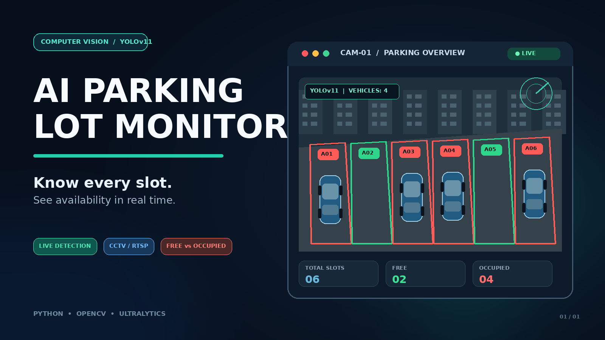

# AI Parking Lot Monitor



**Know which parking slots are free — in real time, from any camera.**

Connect a CCTV feed or webcam, define your parking bays once in a config file, and this system instantly tells you which slots are **FREE** and which are **OCCUPIED** — live, on screen, every second. Built with [YOLOv11](https://docs.ultralytics.com/) and OpenCV.

Whether you're managing a mall, hospital, office campus, or building a smart-city prototype — this gives you actionable occupancy data without expensive hardware or cloud subscriptions.


---

## What It Does

Plug in any parking lot camera. The system:

- **Identifies every car, bike, bus, and truck** the moment it enters a bay
- **Tracks each vehicle** so the occupancy reading stays stable even under occlusion or lighting changes
- **Lights up each bay** green (FREE) or red (OCCUPIED) on a live annotated video
- **Logs a running count** — total slots, free, occupied — updated every frame

```
Total: 6  |  Free: 2  |  Occupied: 4
```

No cloud. No subscription. Runs on a laptop or a Raspberry Pi-class device. Annotated output saved to `runs/parking_output.mp4`.

---

## Features

| Feature | What you get |
|---|---|
| 🚗 Real-time occupancy | Instant FREE / OCCUPIED status per bay, updated every frame |
| 🎯 YOLOv11 detection | Recognizes cars, motorcycles, buses, and trucks out of the box |
| 🔁 Stable tracking | Vehicles keep their identity across frames — no flickering status changes |
| 🟩🟥 Visual overlay | Each parking bay turns green (free) or red (occupied) on the live feed |
| 📷 Any camera source | Works with recorded video files or a live webcam/CCTV stream |
| ⚙️ Zero-code config | Define all bays, thresholds, and model settings in one YAML file |
| 💾 Saved output | Annotated video exported to `runs/parking_output.mp4` automatically |

---

## Project Structure

```
ai_parking_lot_monitor/
├── configs/
│   └── parking.yaml          # All tuneable parameters + slot polygons
├── src/parking_ai/
│   ├── __init__.py
│   ├── cli.py                # Entry point (argparse)
│   ├── config.py             # YAML loader + source resolver
│   ├── detection.py          # VehicleDetector wrapping Ultralytics YOLO
│   ├── geometry.py           # Polygon math, IoU, anchor helpers
│   ├── tracking.py           # IoUTracker — stable IDs across frames
│   ├── parking.py            # ParkingLot + per-slot occupancy state
│   ├── pipeline.py           # ParkingLotPipeline — wires all modules together
│   └── visualization.py     # HUD drawing helpers
├── requirements.txt
└── README.md
```

---

## Quick Start

### 1. Clone & set up the environment

```bash
git clone https://github.com/<your-username>/ai_parking_lot_monitor.git
cd ai_parking_lot_monitor

python -m venv .venv
source .venv/bin/activate          # Windows: .venv\Scripts\activate
pip install -r requirements.txt
```

> Ultralytics downloads **`yolo11n.pt`** automatically on first run (internet required). You can swap the model in `configs/parking.yaml`.

### 2. Configure your parking slots

Open `configs/parking.yaml` and replace the sample polygons with the actual bay corners from your camera feed. Coordinates are **normalized (0.0 – 1.0)** relative to the frame:

```yaml
parking:
  slots:
    - id: "A01"
      polygon: [[0.10, 0.25], [0.22, 0.25], [0.22, 0.48], [0.10, 0.48]]
    - id: "A02"
      polygon: [[0.24, 0.25], [0.36, 0.25], [0.36, 0.48], [0.24, 0.48]]
```

### 3. Run

**Video file:**
```bash
PYTHONPATH=src python -m parking_ai.cli --config configs/parking.yaml --source input.mp4
```

**Webcam:**
```bash
PYTHONPATH=src python -m parking_ai.cli --config configs/parking.yaml --source 0
```

**Headless (no display window):**
```bash
PYTHONPATH=src python -m parking_ai.cli --config configs/parking.yaml --source input.mp4 --no-show
```

---

## Configuration Reference

All settings live in `configs/parking.yaml`:

```yaml
video:
  source: "input.mp4"          # path to video file or 0 for webcam
  output: "runs/parking_output.mp4"
  show: true                   # display live window
  resize_width: 960            # resize input frames to this width

detector:
  model: "yolo11n.pt"          # any Ultralytics-compatible model
  confidence: 0.28             # detection confidence threshold
  iou: 0.50                    # NMS IoU threshold
  classes: [2, 3, 5, 7]        # COCO: car, motorcycle, bus, truck

tracking:
  enabled: true
  max_age: 18                  # frames to keep a lost track alive
  match_iou: 0.20              # minimum IoU to associate detection → track

parking:
  occupancy_threshold: 0.18   # overlap fraction to mark a slot occupied
  anchor: "bottom_center"      # bottom_center | center
  slots: [...]                 # list of {id, polygon} entries
```

### Tuning tips

- **`occupancy_threshold`** — raise it if adjacent vehicles trigger neighboring bays; lower it if partially visible cars are missed.
- **`anchor: bottom_center`** — works best for side/elevated cameras where the wheel contact point is visible. Switch to `center` for overhead views.
- **`max_age`** — increase for slower-moving traffic or scenes with occlusion.
- **Model** — swap `yolo11n.pt` → `yolo11s.pt` / `yolo11m.pt` for better accuracy at the cost of speed.

---

## How It Works

```
Camera / Video feed
        │
        ▼
  YOLOv11 detects every vehicle  ──► bounding boxes per frame
        │
        ▼
  IoU Tracker assigns stable IDs  ──► same car = same ID across frames
        │
        ▼
  Each bay polygon checked  ──► is a vehicle inside this slot?
        │
        ▼
  Live overlay rendered  ──► green = FREE, red = OCCUPIED, count updated
```

1. **Detection** — YOLOv11n spots every car, bike, bus, and truck in the current camera view.
2. **Tracking** — Each vehicle gets a stable ID so the bay status doesn't flicker when detection confidence dips for a frame.
3. **Occupancy check** — For every configured bay polygon, the system checks whether a vehicle is parked inside using geometric overlap. One YAML change adjusts sensitivity.
4. **Live output** — Bays turn green or red instantly. The running FREE / OCCUPIED count is shown in the corner of the feed.

---

## Requirements

| Package | Version |
|---|---|
| Python | 3.10 or 3.11 |
| ultralytics | ≥ 8.3.0 |
| opencv-python | ≥ 4.9.0 |
| numpy | ≥ 1.26.0 |
| PyYAML | ≥ 6.0.1 |

Install everything with:
```bash
pip install -r requirements.txt
```

---

## Contributing

Contributions are welcome! Here's how to get started:

1. **Fork** this repository
2. **Create a branch** for your feature or fix: `git checkout -b feature/my-improvement`
3. **Commit** your changes with a clear message
4. **Push** to your fork and open a **Pull Request**

### Ideas for contribution

- [ ] ByteTrack / BoT-SORT integration for crowded scenes
- [ ] Multi-camera support
- [ ] REST API / WebSocket endpoint for live occupancy data
- [ ] Web dashboard (Streamlit / Gradio)
- [ ] Slot polygon calibration tool (click-to-define bays on a frame)
- [ ] Docker image

Please open an issue first if you're planning a large change, so we can discuss the approach.

---

## Known Limitations

- **Bay polygons are camera-specific.** The sample coordinates are a starting template — you must draw your own for your camera angle.
- **Tracker is lightweight by design.** Works great for normal traffic. For packed lots or heavy occlusion, swap in ByteTrack/BoT-SORT via Ultralytics.
- **No bundled footage or weights.** YOLOv11n downloads automatically on first run; bring your own camera or video file.

---

## License

This project is released under the [MIT License](LICENSE).

---

## Acknowledgements

- [Ultralytics YOLOv11](https://docs.ultralytics.com/) for the detection backbone
- [OpenCV](https://opencv.org/) for video I/O and drawing
